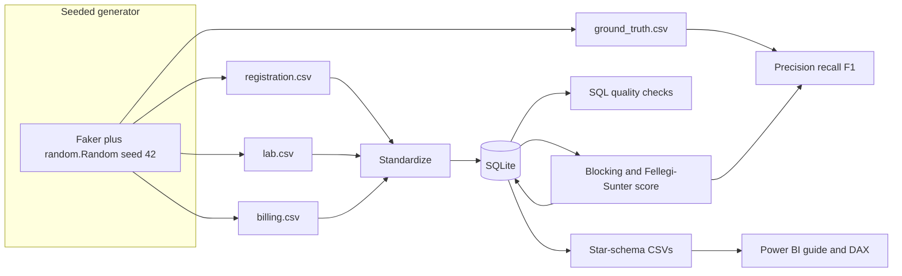

# EMPI Final Project

Portfolio project by Chidi. Synthetic data only. This is study and interview practice for healthcare data analyst and BI roles, including Microsoft PL-300 and the HL7 FHIR R4 Patient model. It is not a system that was implemented in a hospital, and it does not describe a job.

**Synthetic data only.** Every person in this repository was generated. There is no real patient, no real medical record number, and no PHI. Do not add a real extract. `data/local/` is gitignored for that reason. Lakeside Health, the three source systems, and the identifier URIs under `lakeside.example.org` are fictional. Email addresses use `example.com`.

## The problem

A master patient index decides whether two charts are the same person. When they are, and the organization does not know it, lab results and bills attach to the wrong chart or to a second chart. When they are not, and a system links them anyway, two people's records are mixed. Both errors are patient-safety problems. The FHIR R4 Patient page describes duplicate registration as a known problem and says that around 2% of registrations are in error, mostly duplicates ([Patient](https://hl7.org/fhir/R4/patient.html)).

This project builds a small, inspectable version of that problem:

1. Generate about 8,000 fictional people and inject extra charts at about a 2% rate, with the kinds of mistakes registration systems actually see.
2. Standardize names, phones, SSNs, addresses, and dates.
3. Load a local SQLite database shaped loosely on the FHIR R4 Patient resource.
4. Score candidate pairs and separate them into auto-link, manual review, and non-match.
5. Publish a star schema, DAX measures, and a Power BI build guide so the same numbers can be shown in a report.

## What the seeded run found

`python -m empi` builds all five scenarios (about 9 seconds on the machine that produced this commit) and writes one star schema with a `scenario_key` on every fact. Faker is 33.1.0. Each scenario has its own seed. `python -m empi --scenario hard_cases` builds one. `--persons` and `--duplicates` only apply with `--scenario`.

| Scenario | Seed | Charts | Injected rate | Auto-link P / R / F1 | FP | Review pairs | Flagged P / R / F1 | Core completeness |
| --- | ---: | ---: | ---: | --- | ---: | ---: | --- | ---: |
| Baseline | 42 | 8,170 | 2.08% (170/8,170) | 1.000 / 0.941 / 0.970 | 0 | 10 | 1.000 / 1.000 / 1.000 | 0.990 |
| Hospital merger | 43 | 4,400 | 9.09% (400/4,400) | 1.000 / 0.940 / 0.969 | 0 | 24 | 1.000 / 1.000 / 1.000 | 0.990 |
| Messy data entry | 44 | 3,080 | 2.60% (80/3,080) | 1.000 / 0.938 / 0.968 | 0 | 5 | 1.000 / 1.000 / 1.000 | 0.952 |
| Hard cases | 45 | 2,570 | 2.72% (70/2,570) | 0.653 / 0.943 / 0.772 | 35 | 16 | 0.598 / 1.000 / 0.749 | 0.990 |
| Lab migration | 46 | 3,090 | 2.91% (90/3,090) | 1.000 / 0.800 / 0.889 | 0 | 13 | 1.000 / 0.944 / 0.971 | 0.977 |

Counts are in `outputs/scenario_metrics.csv`.

**Baseline** is the original file. Auto-link is 160 true positives, 0 false positives, 10 false negatives. The 10 misses are `name_dob_only`: same name and birth date, different address, no shared phone or SSN. They stay in review. Blocking also scored 11,457 non-duplicate baseline pairs; every one of them scored below 0.05. This file has no twins and no shared household phones.

**Hospital merger** raises the injected rate to about 9%, the rate you might see after combining two registration systems. The matcher still separates them here because the extra charts keep a second identifier. The review queue grows with the volume (24 pairs), and the suspected duplicate *record* rate is 17.1% because both charts in each auto-link are counted.

**Messy data entry** leaves precision at 1 and pulls core completeness down to 0.952. The issue file has 3,555 rows on 3,080 charts, led by missing SSN (1,177) and missing phone (671). Duplicate recall stays high because most injected pairs still share something stable.

**Hard cases** is where precision breaks. Twenty twin pairs share a last name, birth date, address, and phone and have no SSN, and fifteen household pairs share a last name, address, and phone with different birth dates. Those 35 pairs are different people and they auto-link (precision 0.653, 66 true positives and 35 false positives). Twelve more twin pairs keep different SSNs, so the conflict rule holds them in review. Flagged precision is 0.598 (47 false positives). Common names such as John Smith are in the population so the blocker has more lookalikes; they are not, by themselves, the false links.

**Lab migration** damages the laboratory feed on purpose: SSN dropped, phone often missing or the text `SEE CHART`, and some birth dates and addresses unusable. Auto-link recall falls to 0.800 (72/90). Five true pairs never enter a block (`true_pairs_unblocked` = 5), so even the review queue misses them (flagged recall 0.944). Precision stays 1. A broken source hides duplicates. It does not, in this file, invent them.

Auto-link means the score is at least 0.95, a second identifier or a matching street agrees, and there is no conflicting SSN and no conflicting known gender. Those 160 pairs are grade `certain`. The 10 false negatives are the `name_dob_only` variant: same given name, family name, and birth date, with a different address and no shared phone or SSN. They score in the 0.70–0.85 range and stay in manual review (`probable` or `possible`). That is the point of the review band. A name and a birth date, with nothing else in common, do not retire a chart.

The other injected patterns all auto-linked: nickname, typo, transposed month and day, swapped given and family names, maiden name with SSN and phone kept, missing SSN, missing phone, address formatting, and phone formatting. Recall by variant is in `outputs/eval_recall_by_variant.csv`.

Blocked pairs that are not duplicates: 11,287. Every one of them scored below 0.05. The histogram is in `outputs/eval_score_histogram.csv`. This separation is a property of this synthetic file. People do not share phone numbers or SSNs except where a duplicate was injected, and the generator does not create twins. A real registration file has household phones, twins, and common names with the same birth date. Those cases would land in the middle of the score range. The threshold curve (`outputs/eval_threshold_metrics.csv`) is still worth plotting: at 0.55, recall of true pairs is 1.000; at 0.78 it is 0.988 (168/170); at 0.95 it is 0.941 (160/170). Precision stays 1.000 across that range on this file.

### Two different duplicate rates

Use the one that matches the question.

These three are the baseline numbers. Filter the dashboard to Baseline before you quote them. The merger row is the place to see the record rate and the pair rate diverge (17.1% of charts sit in an auto-link, while 9.09% of charts were injected extras).

| Question | Numerator | Baseline |
| --- | --- | --- |
| What fraction of charts did the generator add as extras? | 170 injected charts / 8,170 | 2.08% |
| What fraction of charts sit in an auto-link? | 320 charts (both sides of 160 pairs) / 8,170 | 3.92% |
| How many extra charts did auto-link imply, if each pair is disjoint? | 160 pairs / 8,170 | 1.96% |

The 3.92% figure counts the original chart and the duplicate. The 1.96% figure is closer to the injected rate and is lower than 2.08% because 10 true pairs were left in review. On Hard cases the "both sides" shortcut is wrong: 35 false links mean some charts sit in more than one pair, so use the distinct `in_auto_link` flag (7.86% of hard-case charts). The DAX measure does that. The injected rate uses the answer key and belongs on the comparison page.

### Source systems and data quality

| Source | Charts | Active after linking | Mean core completeness |
| --- | --- | --- | --- |
| Registration | 5,836 | 5,671 | 0.990 |
| Laboratory | 1,340 | 1,306 | 0.989 |
| Billing | 994 | 971 | 0.992 |

Core completeness is the share of six fields present: given name, family name, birth date, a known administrative gender, street, and postal code. It is high because those fields are usually filled in. Phone and SSN are outside that score on purpose. The issue table is where they show up:

| Issue | Severity | Rows |
| --- | --- | --- |
| Missing SSN | warning | 927 |
| Missing phone | warning | 418 |
| Shared SSN across charts | warning | 292 |
| Shared phone and birth date | warning | 252 |
| Gender unknown | warning | 238 |
| Exact normalized name and birth date | warning | 122 |
| Missing street | warning | 93 |
| Invalid phone | error | 85 |
| Invalid postal code | error | 64 |
| Invalid SSN | error | 50 |
| Unrecognized sex value | warning | 33 |
| Unparseable birth date | error | 32 |
| Missing family name | error | 16 |
| Missing MRN | error | 9 |
| Missing given name | error | 5 |

Shared-SSN and exact-name rows include the injected duplicates. They are deterministic signals, not proof.

## Why the matching is shaped this way

Blocking keeps the comparison set small. A pair is scored when the charts share an SSN, a phone, a Soundex of the family or given name plus birth year, or a Soundex plus the full birth date. The given name is also indexed under the family-name key so a swapped-name chart still meets its partner. The largest block in this run held 10 charts. None were skipped.

The score is Fellegi-Sunter in form. For each field, agreement adds log2(m/u) and disagreement adds log2((1-m)/(1-u)). A missing value adds nothing. m and u are written in `empi/config.py`. They are assumptions about blocked pairs, not an expectation-maximization fit on a production file. The sum is a log2 likelihood ratio. With a prior of 0.02, the posterior probability is the 0–1 score. Jaro-Winkler supplies partial credit on names and street lines. A small nickname list treats Bill and William as the same given name. A month/day swap is its own birth-date status, weaker than an exact date and stronger than a mismatch.

Decision policy, after the score:

| Grade | Score | What we do |
| --- | --- | --- |
| certain | ≥ 0.95, and corroborated, and no identity conflict | Auto-link. Write `Patient.link`. |
| probable | ≥ 0.78, or a certain score that failed the corroboration rule | Manual review. No link yet. |
| possible | ≥ 0.55 | Manual review. No link yet. |
| certainly-not | < 0.55 | Not stored. |

Corroboration means an exact SSN plus some demographic agreement, or an exact phone plus a name or birth date, or an exact birth date plus both names plus the street. A hard SSN disagreement or a disagreement between two known genders caps the pair at review. FHIR's own grade definitions line up with this caution: `certain` may be treated as a match, `probable` may need a person, and `possible` should be reviewed ([match-grade](https://hl7.org/fhir/R4/valueset-match-grade.html)).

Survivorship, when a pair is auto-linked: keep the chart with the higher core completeness; if they tie, keep the later received date; then prefer registration, then billing, then lab. The other chart gets `link.type = replaced-by` and `active = false`. The survivor gets `link.type = replaces`. Nothing is copied from the retired chart onto the survivor. FHIR R4 does not define an operation that would do that copy.

## Architecture



`ground_truth.csv` is drawn off to the side on purpose. The scorer never reads it. It is loaded into `eval_ground_truth` only after pairs are stored, and the evaluation SQL recomputes the same true-positive counts as the Python metrics. The pipeline stops if those two counts differ.

## How to run

Python 3.11 or newer.

```bash
python -m venv .venv
source .venv/bin/activate          # Windows: .venv\Scripts\activate
pip install -r requirements.txt
python -m empi                     # all five scenarios
python -m empi --scenario hard_cases
python -m empi --scenario baseline --persons 400 --duplicates 12
pytest
```

`python -m empi` is the whole path: generate, standardize, load, quality checks, match, evaluate, export. `--all-scenarios` is the same as the default. `--persons`, `--duplicates`, and `--seed` change one scenario, so they require `--scenario`.

The database is `data/empi.db` (gitignored, rebuilt every run). Open a single check in the sqlite3 shell or DB Browser:

```bash
sqlite3 data/empi.db
```

```sql
SELECT issue_type, severity, COUNT(*) AS issue_count
FROM data_quality_issue
GROUP BY 1, 2
ORDER BY issue_count DESC;
```

The named queries live in `sql/data_quality_queries.sql` and `sql/evaluation_queries.sql`. Each block has a `purpose` comment. The pipeline also writes `outputs/query_results/`.

Tests cover standardization, the score and the decision rules, the SQL issue checks, and a smaller end-to-end run. GitHub Actions runs `pytest` on push and pull request (`.github/workflows/tests.yml`).

## Project structure

```text
empi/                         Python package
  scenarios.py                Named populations and their seeds
  generate.py                 Seeded synthetic extracts
  standardize.py              Names, phones, SSNs, dates, addresses, gender
  match.py                    Blocking, score, grades, links
  pipeline.py                 python -m empi
sql/schema.sql                SQLite schema
sql/data_quality_queries.sql  Issue checks and analyst reports
sql/evaluation_queries.sql    Answer-key precision inputs
data/synthetic/<scenario>/    Source CSVs and ground_truth.csv for each scenario
outputs/                      Star schema, metrics, $match samples, query results
docs/power-bi-build-guide.md  Desktop steps mapped to PL-300
docs/dax-measures.dax         Measures, with a comment on each
docs/data-dictionary.md       Column definitions
tests/                        pytest
```

## FHIR R4 notes

The model follows the R4 Patient resource, not a full FHIR server.

- **The MRN is an identifier.** Each chart stores `Patient.identifier` as a system URI plus a value, with type `MR` from `http://terminology.hl7.org/CodeSystem/v2-0203`. A structural SSN, when it passes the format check, uses `http://hl7.org/fhir/sid/us-ssn` and type `SS`. The numbers are fabricated.
- **The resource id is not the MRN.** `fhir_logical_id` (for example `pat-REG-000028`) is the Patient resource id. R4 says a resource id does not change, and an MRN can, so the MRN belongs in `identifier` ([Patient: ids](https://hl7.org/fhir/R4/patient.html)).
- **Administrative gender** is `male`, `female`, `other`, or `unknown`. Source values such as `M`, `Female`, and `X` are mapped. Anything else is stored as `unknown` and flagged.
- **Name, telecom, address, birthDate, active** are stored. `name.use` is `official`, `nickname`, or `maiden` when the source row says so.
- **`Patient.link`** is written only for auto-link. The retired chart points at the survivor with `replaced-by`. The survivor points back with `replaces`. Review pairs do not get a link, because a link asserts that the two resources concern the same person ([link-type](https://hl7.org/fhir/R4/codesystem-link-type.html)). `refer` and `seealso` are legal codes and are not needed for this duplicate-chart set. `seealso` would be the R4 pattern for two records that are both still valid.
- **`$match` shape.** `outputs/match_examples.json` holds a Parameters request and a searchset Bundle for one certain pair and one review pair. The Bundle entry has `search.score` between 0 and 1 and the `match-grade` extension. R4's Patient operations are `$match` and `$everything` ([operations](https://hl7.org/fhir/R4/patient-operations.html), [`$match`](https://hl7.org/fhir/R4/patient-operation-match.html)). This file is an example of that shape. It is not a response from a server.
- **FHIR R4 does not define merge.** There is no `$merge` on Patient in R4. Linking and setting `active` to false is what this project does. The word "merged" appears in the R4 description of the `replaces` link type, and the spec still leaves the business process of combining charts outside the base operations. FHIR R5 later added a trial-use `Patient/$merge` ([R5 $merge](https://hl7.org/fhir/R5/patient-operation-merge.html)). This project follows R4 and does not implement that operation. Retired demographics stay on the retired resource.

## Power BI

The report is a PL-300 exercise, built by hand from the CSVs. Steps, relationships, and page layouts are in [docs/power-bi-build-guide.md](docs/power-bi-build-guide.md). Measures are in [docs/dax-measures.dax](docs/dax-measures.dax). Column definitions are in [docs/data-dictionary.md](docs/data-dictionary.md).

Suggested pages: an overview of duplicate rate, completeness, and issues; a review queue of pairs; issues by source and type; and a separate evaluation page that is labeled as synthetic. The evaluation page is the one that shows precision and recall. The overview page does not, because those numbers need the answer key.

## Assumptions and limits

- Dates are read as US month/day/year. Phones are US 10-digit numbers. Postal codes are checked as 5-digit strings, not against a USPS file. City and state come from a short built-in list so they agree with each other; street names come from Faker and are not real addresses of real people.
- SSN checks are structural: 9 digits, area not 000, 666, or 9xx, group not 00, serial not 0000. A passing value is not an issued SSN.
- Nickname handling is a short English list in `empi/nicknames.py`.
- The prior, the m and u values, and the 0.95 / 0.78 / 0.55 cut points are choices for this file. They are not a clinical policy.
- Baseline, merger, and messy entry do not generate twins or shared household phones. That is why their false-positive counts are zero. Hard cases does generate them, and that is why its precision is not 1. Say which scenario you are quoting.
- Auto-link does not copy phone, address, or identifiers onto the surviving chart.
- SQL here is a documented set of queries against a local SQLite file built for this portfolio project.

## References

- [HL7 FHIR R4 Patient](https://hl7.org/fhir/R4/patient.html)
- [HL7 FHIR R4 Patient operations](https://hl7.org/fhir/R4/patient-operations.html)
- [HL7 FHIR R4 Patient $match](https://hl7.org/fhir/R4/patient-operation-match.html)
- [HL7 FHIR R4 match-grade value set](https://hl7.org/fhir/R4/valueset-match-grade.html)
- [HL7 FHIR R4 link-type](https://hl7.org/fhir/R4/codesystem-link-type.html)
- [HL7 FHIR R5 Patient $merge](https://hl7.org/fhir/R5/patient-operation-merge.html) (not implemented; R4 is the spec this project follows)
- [PL-300 study guide](https://learn.microsoft.com/en-us/credentials/certifications/resources/study-guides/pl-300)
- Fellegi, I. P., and Sunter, A. B. (1969). A theory for record linkage. *Journal of the American Statistical Association.* The weights in this project use that agree/disagree likelihood-ratio form with stated parameters.
